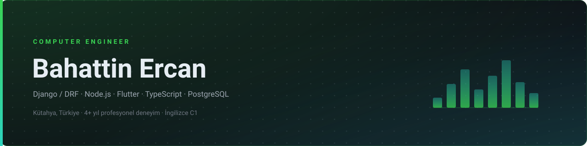
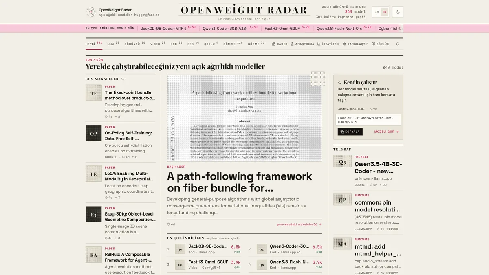
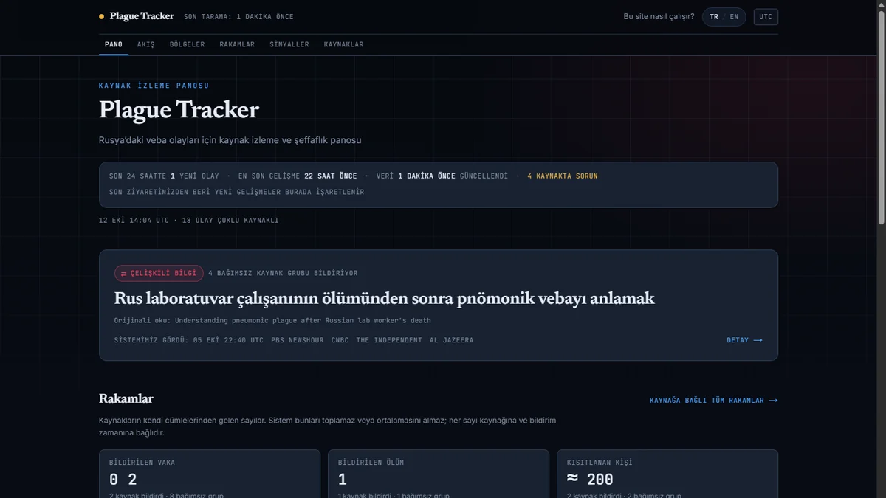
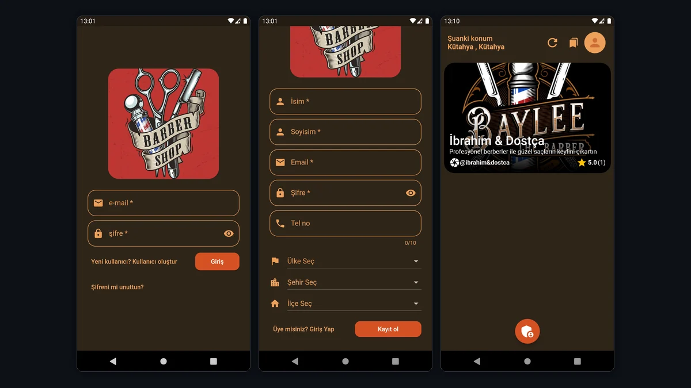
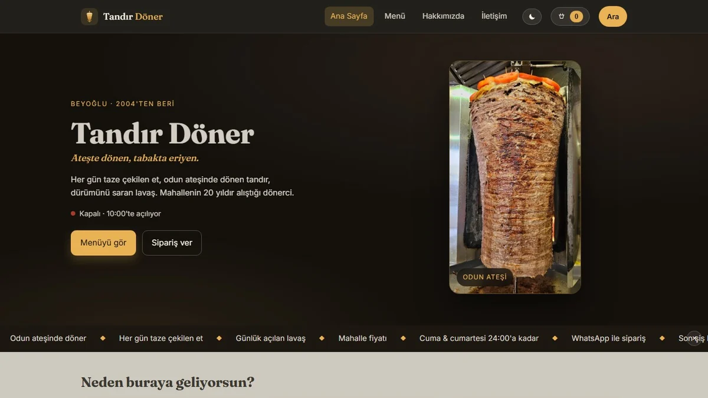
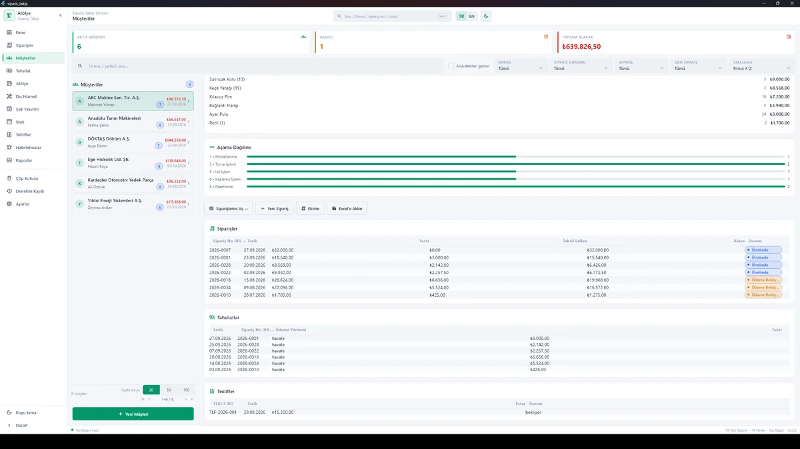
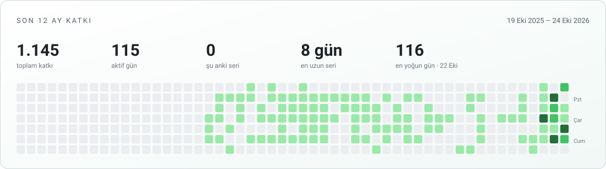

<picture>
  <source media="(prefers-color-scheme: dark)" srcset="assets/banner-dark.svg">
  <source media="(prefers-color-scheme: light)" srcset="assets/banner-light.svg">
  
</picture>

## Kısaca

Çok kiracılı iş uygulamaları, Windows masaüstü araçları ve zamanlanmış veri hatları geliştiriyorum.
Arayüzü Flutter/Dart ile mobil ve masaüstünde, TypeScript ile web'de (Next.js + NestJS) yazıyorum;
veri katmanında PostgreSQL, SQLite ve MongoDB kullanıyorum.

İşi "çalışıyor" noktasında bırakmamaya çalışıyorum: kritik mantığı testle kilitliyorum,
kararları ve kısıtları repo içinde dokümante ediyorum, teslim edilebilir bir sürüm çıkarıyorum.

**In English** — I build multi-tenant business applications, Windows desktop tools and scheduled data pipelines.
Flutter/Dart for mobile & desktop, TypeScript (Next.js + NestJS) for web, PostgreSQL/SQLite/MongoDB for data.
I keep the work past the "it runs" stage: tests around the logic that can silently break, decisions and
constraints documented in the repo, and something that can actually be shipped.

---

## Ne yapıyorum

| | |
|---|---|
| **Çok kiracılı ürünler** | Güzellik salonu platformu (API + web admin + iki Flutter uygulaması) ve çok şirketli bakım-onarım yönetim sistemi. İzolasyon sınırı tenant/şirket, yetkilendirme rol bazlı. |
| **Masaüstü ve mobil** | Windows'ta kurulan çevrimdışı Flutter masaüstü uygulamaları, Flutter mobil uygulamalar, Kotlin/Android oyun prototipleri. |
| **Zamanlanmış veri hatları** | Kaynaklardan toplayan, normalize eden, sınıflandıran ve snapshot olarak yayınlayan ingest sistemleri (Next.js + GitHub Actions / cron). |
| **Arayüz işçiliği** | Sıfır bağımlılık statik siteler, kurumsal paneller, veri yoğun tablo/rapor ekranları. |

---

## Öne çıkan projeler

<table>
<tr>
<td width="50%" valign="top">

### OpenWeight Radar &nbsp;·&nbsp; [canlı](https://local-ai-news.vercel.app)

Yerelde çalıştırılabilir **açık ağırlıklı AI modellerini** kategori sekmeleriyle takip eden, haber akışı zamanlanmış olarak güncellenen izleme sitesi.

`Next.js 16` `TypeScript` `Hugging Face` `GitHub Actions`

Sınıflandırma mantığı 40 fixture'lık regresyon kapısıyla korunuyor; kaynak sağlığı ayrı bir komutla raporlanıyor.

</td>
<td width="50%" valign="top">

### Güzellik Salonu Platformu

**Çok kiracılı** salon yönetimi: Express + Sequelize API, Next.js admin paneli, Flutter salon ve müşteri uygulamaları.

`Express` `Sequelize` `Next.js` `Flutter`

Üretimde varsayılan şifreyle seed çalıştırmayı reddeden koruma; demo veri ile gerçek veri ayrımı.

</td>
</tr>
<tr>
<td width="50%" valign="top">

### Plague Tracker &nbsp;·&nbsp; [canlı](https://plague-tracker.vercel.app)

Haber iddialarını **kaç bağımsız kaynağın bildirdiğine** göre etiketleyen izleme sitesi. Sistem hiçbir yerde "doğrulandı" demez; yalnızca kimin ne bildirdiğini raporlar.

`Next.js` `TypeScript` `Drizzle ORM` `Vercel`

Bağımsızlık grupları, çelişkili bilgi etiketi ve kaynak sağlığı takibi.

</td>
<td width="50%" valign="top">

### Barber Shops

Berber randevu ve personel yönetimi. Flutter uygulaması + Node.js/Express REST API'si; müdür, çalışan ve admin rolleri.

`Flutter` `Dart` `Node.js` `Express`

Randevu, dükkan, servis, yorum ve favori akışlarının tamamı rol bazlı yetkilendirmeyle korunuyor.

</td>
</tr>
<tr>
<td width="50%" valign="top">

### Döner Sipariş Sitesi &nbsp;·&nbsp; [canlı](https://doner-website.vercel.app)

Lokanta için **sıfır bağımlılık** statik sipariş sitesi: WhatsApp üzerinden sipariş, gece modu, localStorage sepet.

`HTML` `CSS` `JavaScript` `MIT`

Derleme adımı ve framework yok — dosyayı kopyala, çalışır. Küçük işletmeler için bakımı bedava.

</td>
<td width="50%" valign="top">

### Müşteri Sipariş Takip

İmalat atölyesi için sipariş → üretim → tahsilat takibi. **Windows masaüstü, çevrimdışı**, veriler yerel SQLite'ta.

`Flutter` `Dart` `SQLite` `Windows`

Çok kalemli sipariş, kullanıcı tanımlı üretim aşamaları, kısmi tahsilat, stok ve raporlar. 725 test / 145 Dart dosyası. [Vaka çalışması](https://github.com/bahattinercan/case-studies/blob/main/docs/musteri-siparis-takip.md) · kaynak kod özel.

</td>
</tr>
</table>

### Bunların dışında

Bazı işler **özel repolarda** yürüyor. Kodları yayınlanmıyor ama mühendislik anlatımları
[kaynak kodu özel olan dört ürünün vaka çalışmaları](https://github.com/bahattinercan/case-studies)
altında: problem, mimari, ölçülmüş kanıt ve bilinen sınırlar.

- **[Bakım Onarım Yönetim Sistemi (CMMS)](https://github.com/bahattinercan/case-studies/blob/main/docs/bakim-onarim-yonetim.md)** —
  Çok şirketli bakım süreci (arıza → SLA → iş emri → saha → kapanış).
  NestJS + Prisma + PostgreSQL, BullMQ outbox, React web, Expo mobil.
  Katman sınırları dependency-cruiser ile denetleniyor; OpenAPI sözleşme kayması CI'da yakalanıyor.
- **[Taskbar Hero](https://github.com/bahattinercan/case-studies/blob/main/docs/new-taskbar-hero.md)** —
  Android için idle RPG. Savaş motoru **saf Kotlin ve sabit adımlı**: aynı seed aynı sonucu
  üretir, denge ölçümü JVM testleriyle tekrarlanabilir. 101 test.
- **[JobRadar](https://github.com/bahattinercan/case-studies/blob/main/docs/find-job.md)** —
  7 kaynaktan iş ilanı toplayan, normalize eden, tekilleştiren ve deterministik skorlayan ingest
  sistemi. Kaynak sağlığı raporu "boru hattı sessizce bozuldu mu?" sorusunu cevaplar.
- **[Müşteri Sipariş Takip](https://github.com/bahattinercan/case-studies/blob/main/docs/musteri-siparis-takip.md)**
  vaka çalışması — 725 test, çevrimdışı lisans/aktivasyon, tek bilgisayar kurulumu.
- **Mavi Konak QR Menü** — Kütahya çini motiflerinden esinlenmiş kafe menüsü sitesi (kaynak özel).
- **[Unity prototip arşivi](https://github.com/bahattinercan/unity-prototypes-archive)** — 2022–2023 arasında C# ile geliştirilmiş 23 oynanabilir prototip:
  hiper-casual, ritim, match-3, üs savunma, VR. Arşiv repo'su mekanikleri ve tekrar eden sistemleri indeksler.
- **E-ticaret üçlüsü** — React vitrin, React admin paneli ve Express + MongoDB backend.

---

## Teknoloji

**Mobil & Masaüstü**

**Web**

**Backend & Veri**

**Oyun & Sistem**

**Araçlar**

---

## Nasıl çalışıyorum

- **Test, sonradan eklenen bir katman değil.** Sessizce bozulabilecek mantığın etrafına test yazıyorum:
  sınıflandırma, skorlama, üretim aşamaları, yetkilendirme.
  *Müşteri Sipariş Takip'te 508 test/112 dosya, Taskbar Hero'da 101 JVM testi.*
- **Kararlar repoda.** Neyin neden böyle olduğu, hangi kısıtın kabul edildiği ve nasıl çalıştırılacağı
  kodun yanında duruyor; sözlü aktarılan bilgiye bırakmıyorum.
- **Gerçek veri ile demo veri karışmıyor.** Geliştirme sentetik veriyle yapılıyor; üretimde
  varsayılan şifreyle seed çalıştırmak reddediliyor.
- **Teslim edilebilir sürüm çıkarıyorum.** Kurulum notu, sürüm numarası, sürüm notu ve yedekleme
  olmadan "bitti" demiyorum.

---

## Sayılar

<picture>
  <source media="(prefers-color-scheme: dark)" srcset="assets/generated/contributions-dark.svg">
  <source media="(prefers-color-scheme: light)" srcset="assets/generated/contributions.svg">
  
</picture>

Kart her gün otomatik yenileniyor ([`stats.yml`](.github/workflows/stats.yml), veri doğrudan
katkı grafiğinden) ve **özel repolardaki katkıları da sayıyor** — hazır istatistik kartları bunu
gösteremez. Bu yüzden buradaki sayı, üstteki aktivite grafiğiyle aynı kaynaktan gelir; popüler
üçüncü parti kartların gösterdiği daha düşük sayı yanıltıcıdır.

---

## Katkı grafiği

<picture>
  <source media="(prefers-color-scheme: dark)" srcset="https://raw.githubusercontent.com/bahattinercan/bahattinercan/output/github-snake-dark.svg">
  <source media="(prefers-color-scheme: light)" srcset="https://raw.githubusercontent.com/bahattinercan/bahattinercan/output/github-snake.svg">
  
</picture>

---

## İletişim

İş görüşmesi, freelance proje veya teknik soru için e-posta en hızlı yol.
Vaka çalışmaları ve iletişim bilgileri portfolyo sitesinde de var:
[bahattinercan-portfolio.vercel.app](https://bahattinercan-portfolio.vercel.app)

