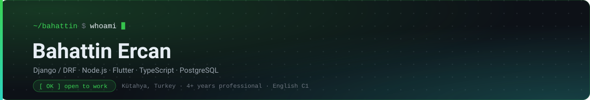
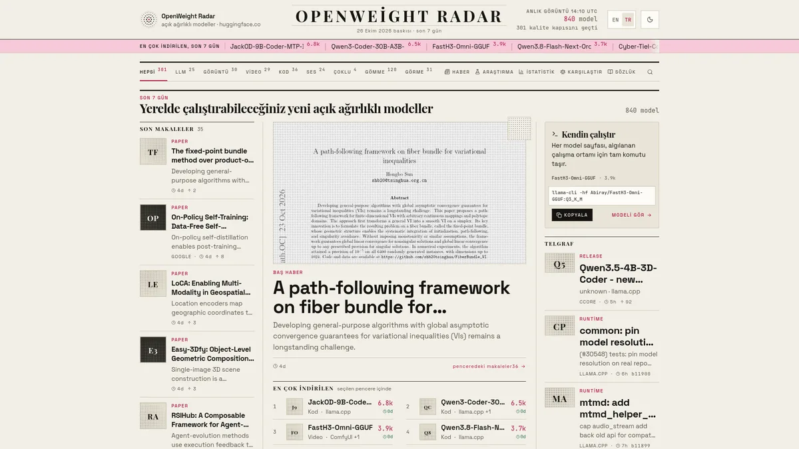
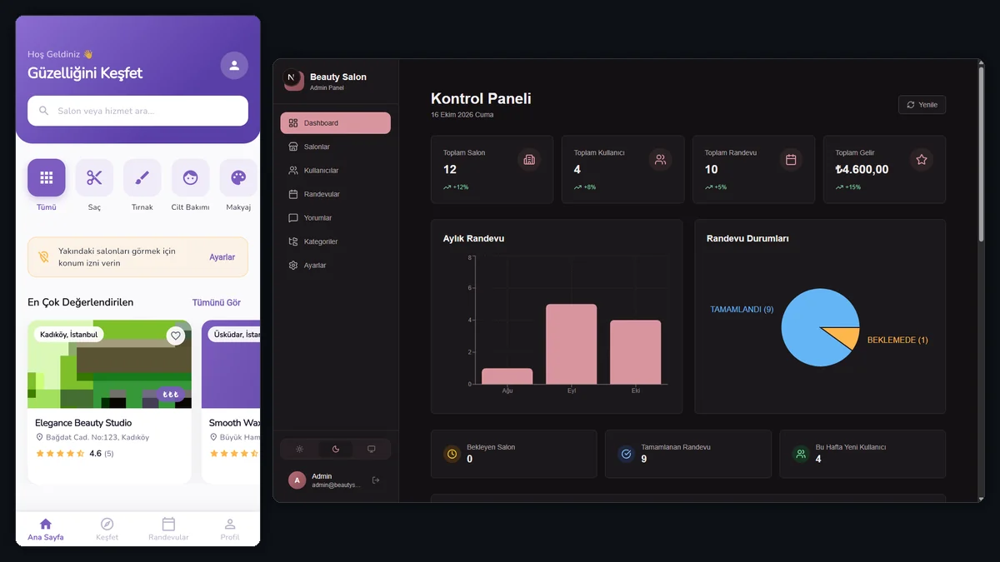
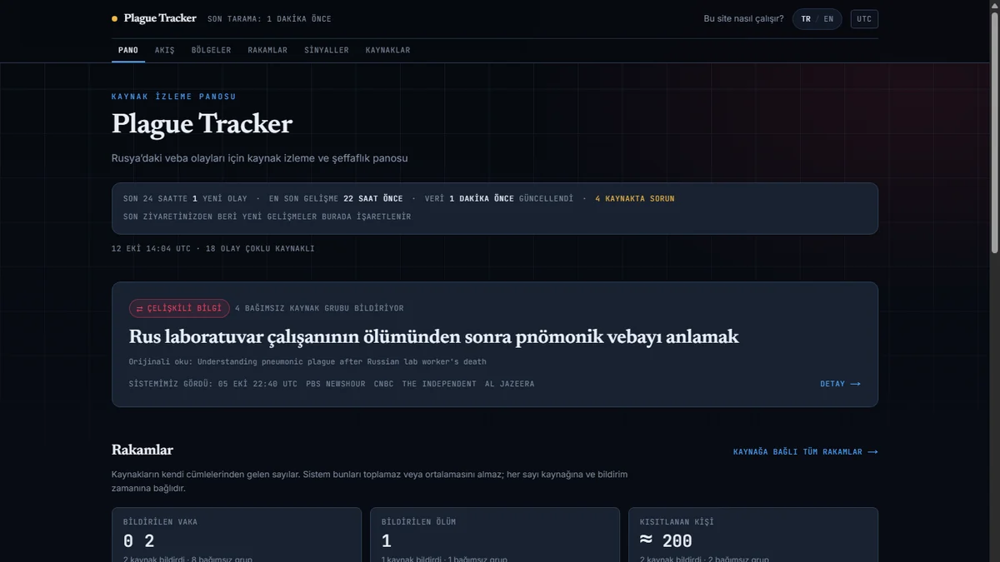
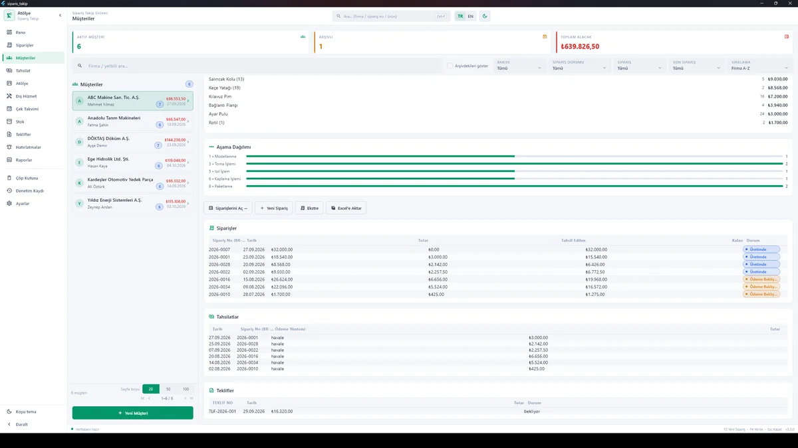
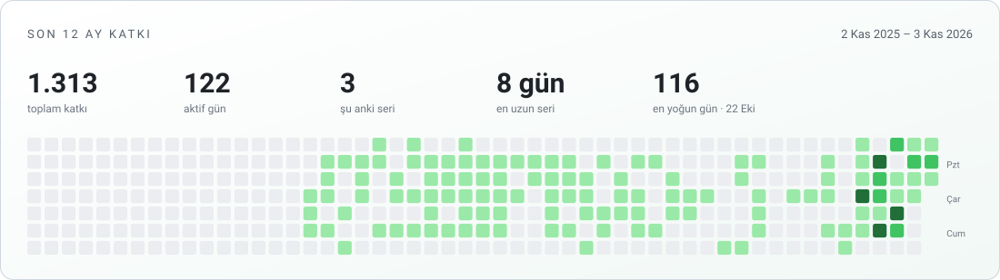

**English** &nbsp;·&nbsp; [Türkçe](README.tr.md)

<picture>
  <source media="(prefers-color-scheme: dark) and (max-width: 640px)" srcset="assets/banner-mobile-dark.svg">
  <source media="(prefers-color-scheme: light) and (max-width: 640px)" srcset="assets/banner-mobile-light.svg">
  <source media="(prefers-color-scheme: dark)" srcset="assets/banner-dark.svg">
  <source media="(prefers-color-scheme: light)" srcset="assets/banner-light.svg">
  
</picture>

## In short

Computer engineer. Code since 2019, 4+ years professional. REST APIs, JWT authentication and
role-based authorization with **Django/DRF**; iOS and Android from one codebase with **Flutter**;
interfaces with **React/Next.js**; hypercasual games with **Unity/C#**.

English **C1** · open to remote work abroad and on-site in Türkiye · available now.

## Selected work

<table>
<tr>
<td width="50%" valign="top">

### [OpenWeight Radar](https://local-ai-news.vercel.app)

Tracking site for open-weight AI models you can run locally; the feed refreshes on a schedule.

Next.js 16 · TypeScript · Hugging Face

Classification is locked by a 40-fixture regression gate.

</td>
<td width="50%" valign="top">

### [Beauty Salon Platform](https://github.com/bahattinercan/beauty-salon)

Multi-tenant salon management: API, web admin and two Flutter apps. One backend, four clients.

Express · Sequelize · Next.js · Flutter

535 tests · tenant isolation tested · default-password seeds blocked in code.

</td>
</tr>
<tr>
<td width="50%" valign="top">

### [Plague Tracker](https://plague-tracker.vercel.app)

Labels news claims by **how many independent sources report them**. It never says "confirmed";
it reports who said what.

Next.js · TypeScript · Drizzle ORM · Vercel

Five label levels, independence groups, source health; TR/EN.

</td>
<td width="50%" valign="top">

### [Order Tracker](https://github.com/bahattinercan/case-studies/blob/main/docs/musteri-siparis-takip.md)

Order → production → collection tracking for a manufacturing workshop. Windows desktop,
offline, local SQLite. Source is private; the case study is public.

Flutter · Dart · SQLite · Windows

725 tests · partial payments · offline licence verification.

</td>
</tr>
</table>

Six public projects, four closed-source case studies, full experience and stack:
**[portfolio](https://bahattinercan-portfolio.vercel.app)** ·
**[how I work](https://bahattinercan-portfolio.vercel.app/#yaklasim)**

## Stack

**Django** · DRF · **Node.js** · NestJS · **Flutter** · TypeScript · React/Next.js · Angular ·
PostgreSQL · Docker · Git

## Contributions

<picture>
  <source media="(prefers-color-scheme: dark)" srcset="assets/generated/contributions-dark.svg">
  <source media="(prefers-color-scheme: light)" srcset="assets/generated/contributions.svg">
  
</picture>

Rebuilt daily from the contribution graph and **counts private repositories** too
([`stats.yml`](.github/workflows/stats.yml)).

**Get in touch:** [bahattin.ercan.43@gmail.com](mailto:bahattin.ercan.43@gmail.com)

