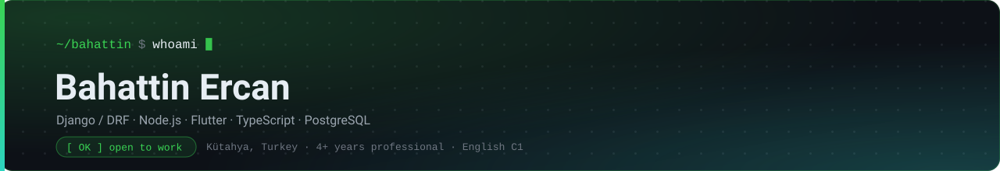
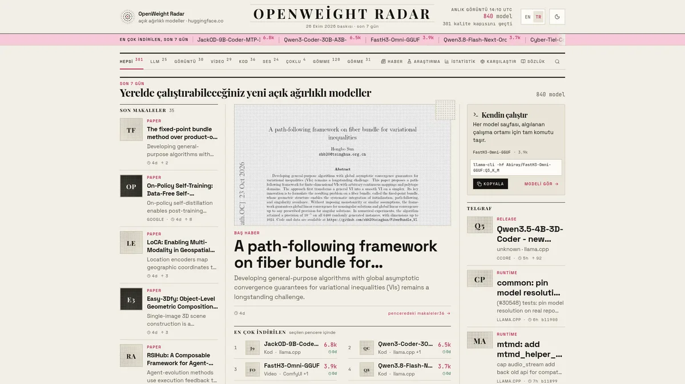
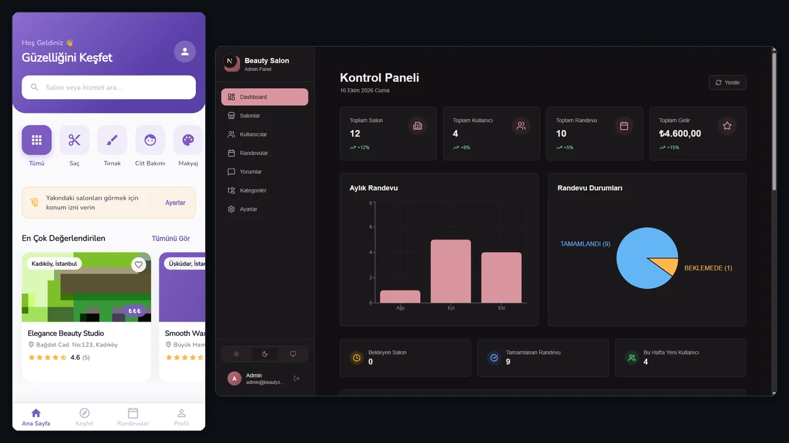
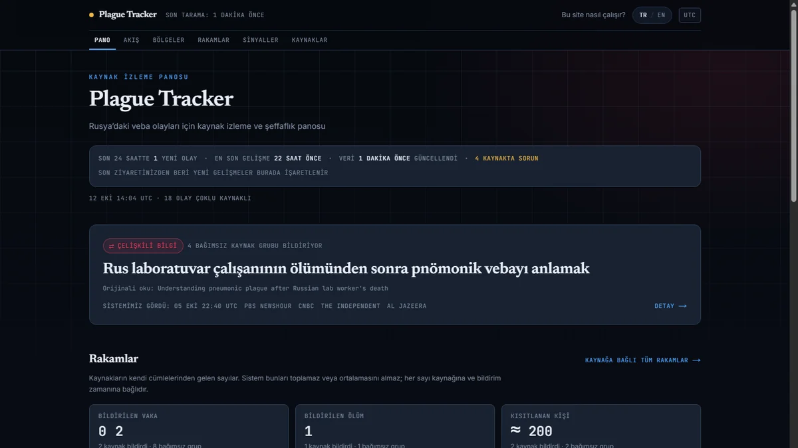
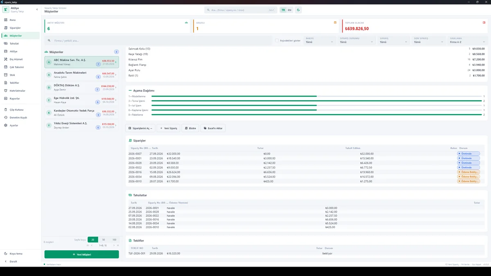
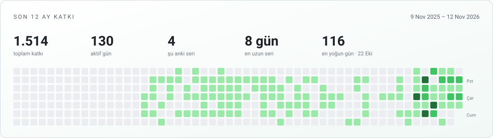

[English](README.md) &nbsp;·&nbsp; **[Türkçe](README.tr.md)**

<picture>
  <source media="(prefers-color-scheme: dark) and (max-width: 640px)" srcset="assets/banner-mobile-dark.svg">
  <source media="(prefers-color-scheme: light) and (max-width: 640px)" srcset="assets/banner-mobile-light.svg">
  <source media="(prefers-color-scheme: dark)" srcset="assets/banner-dark.svg">
  <source media="(prefers-color-scheme: light)" srcset="assets/banner-light.svg">
  
</picture>

## Kısaca

Bilgisayar mühendisi. 2019'dan beri kod yazıyorum, 4+ yılı profesyonel. **Django/DRF** ile REST API,
JWT kimlik doğrulama ve rol bazlı yetkilendirme; **Flutter** ile tek kod tabanından iOS ve Android;
**React/Next.js** ile arayüz; **Unity/C#** ile hypercasual oyunlar.

İngilizce **C1** · yurt dışı remote ve Türkiye'de yerinde çalışmaya açık · hemen başlayabilirim.

## Seçili işler

<table>
<tr>
<td width="50%" valign="top">

### [OpenWeight Radar](https://local-ai-news.vercel.app)

Yerelde çalıştırılabilir açık ağırlıklı AI modellerini takip eden, akışı zamanlanmış olarak güncellenen site.

Next.js 16 · TypeScript · Hugging Face

Sınıflandırma 40 fixture'lık regresyon kapısıyla kilitli.

</td>
<td width="50%" valign="top">

### [Güzellik Salonu Platformu](https://github.com/bahattinercan/beauty-salon)

Çok kiracılı salon yönetimi: API, web panel ve iki Flutter uygulaması. Tek backend, dört istemci.

Express · Sequelize · Next.js · Flutter

535 test · kiracı izolasyonu test edilmiş · varsayılan şifreyle seed kodla engelli.

</td>
</tr>
<tr>
<td width="50%" valign="top">

### [Plague Tracker](https://plague-tracker.vercel.app)

Haber iddialarını **kaç bağımsız kaynağın bildirdiğine** göre etiketler. Hiçbir yerde "doğrulandı"
demez; kimin ne dediğini raporlar.

Next.js · TypeScript · Drizzle ORM · Vercel

Beş etiket seviyesi, bağımsızlık grupları, kaynak sağlığı; TR/EN.

</td>
<td width="50%" valign="top">

### [Müşteri Sipariş Takip](https://github.com/bahattinercan/case-studies/blob/main/docs/musteri-siparis-takip.md)

İmalat atölyesi için sipariş → üretim → tahsilat takibi. Windows masaüstü, çevrimdışı, yerel SQLite.
Kaynak kodu özel, vaka çalışması açık.

Flutter · Dart · SQLite · Windows

725 test · kısmi tahsilat · çevrimdışı lisans doğrulaması.

</td>
</tr>
</table>

Altı açık proje, dört kapalı kaynak vaka çalışması, tam deneyim ve yetenek listesi:
**[portfolyo](https://bahattinercan-portfolio.vercel.app)** ·
**[nasıl çalışıyorum](https://bahattinercan-portfolio.vercel.app/#yaklasim)**

## Yığın

**Django** · DRF · **Node.js** · NestJS · **Flutter** · TypeScript · React/Next.js · Angular ·
PostgreSQL · Docker · Git

## Katkı

<picture>
  <source media="(prefers-color-scheme: dark)" srcset="assets/generated/contributions-tr-dark.svg">
  <source media="(prefers-color-scheme: light)" srcset="assets/generated/contributions-tr.svg">
  
</picture>

Her gün katkı grafiğinden yeniden üretiliyor ve **özel repolardaki katkıları da sayıyor**
([`stats.yml`](.github/workflows/stats.yml)).

**İletişim:** [bahattin.ercan.43@gmail.com](mailto:bahattin.ercan.43@gmail.com)

